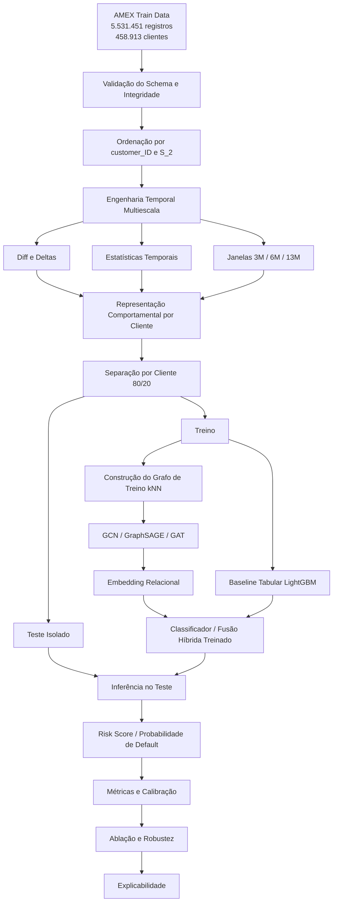

# GNN para Detecção de Inadimplência em Cartões de Crédito utilizando Características Relacionais e Temporais

## 1. Visão Geral

Este estudo propõe uma metodologia baseada em **Graph Neural Networks (GNNs)** para detecção de inadimplência em cartões de crédito utilizando a base pública **American Express Default Prediction (AMEX)**.

A proposta parte da hipótese de que o comportamento financeiro de um cliente pode conter informação relacional adicional quando comparado com os comportamentos de outros clientes semelhantes. Em vez de representar cada cliente exclusivamente como um vetor independente de atributos, o estudo constrói uma representação em grafo na qual os clientes são nós e as relações são determinadas por similaridade comportamental.

A segunda dimensão da proposta é temporal. O histórico financeiro disponível para cada cliente é representado em diferentes horizontes de observação, permitindo investigar se relações estabelecidas a partir do comportamento recente, intermediário e histórico apresentam diferentes capacidades de discriminação de risco.

A metodologia, portanto, combina três componentes principais:

1. **Representação comportamental:** transformação do histórico mensal de cada cliente em características estatísticas e temporais;
2. **Representação relacional:** construção de grafos de similaridade entre clientes;
3. **Aprendizado em grafos:** utilização de GCN, GraphSAGE e GAT para aprender representações relacionais e classificá-las quanto à probabilidade de inadimplência.

Como extensões analíticas, o estudo investiga o **Risk Score calibrado** e a **explicabilidade das decisões da GNN**. O escopo foca exclusivamente no núcleo relacional-temporal supervisionado, eliminando complexidades não essenciais (como aprendizado por reforço).

A abordagem foi desenhada como uma investigação independente sobre inadimplência em crédito. O objetivo é avaliar a hipótese central: **se a estrutura relacional dos clientes, combinada com informação temporal, fornece informação preditiva adicional que não é capturada por modelos tabulares independentes**.

---

## 2. Pergunta de Pesquisa

### Pergunta principal

> **A representação relacional e temporal de clientes por meio de Graph Neural Networks melhora a detecção de inadimplência em cartões de crédito em comparação com modelos tabulares tradicionais?**

### Perguntas secundárias

1. A construção de relações entre clientes com base em similaridade comportamental adiciona informação preditiva além dos atributos individuais?
2. Diferentes horizontes temporais produzem estruturas relacionais com diferentes capacidades de detecção de inadimplência?
3. GAT, GraphSAGE e GCN apresentam comportamentos distintos na representação de relações de risco entre clientes?
4. A combinação de embeddings relacionais com características tabulares melhora o desempenho em comparação com a utilização isolada da GNN?
5. As probabilidades produzidas pela GNN podem ser transformadas em um Risk Score calibrado e interpretável?
6. As explicações do modelo permitem identificar quais características temporais e quais relações entre clientes contribuíram para cada decisão?

---

## 3. Hipóteses

### H1 — Hipótese relacional
> Clientes com características financeiras e comportamentais semelhantes podem apresentar padrões de risco relacionados, e a utilização dessas relações por uma GNN melhora a detecção de inadimplência em relação a modelos que tratam cada cliente como uma observação independente.

### H2 — Hipótese temporal
> A representação de clientes em diferentes horizontes temporais permite capturar diferentes manifestações do comportamento financeiro e produz informação complementar para a predição de inadimplência.

### H3 — Hipótese híbrida
> Embeddings produzidos pela GNN podem conter informação relacional complementar às características tabulares, de modo que a combinação de ambos pode apresentar desempenho superior à utilização isolada das duas representações.

### H4 — Hipótese de explicabilidade
> A análise conjunta de contribuições das características e das relações entre clientes pode produzir explicações mais informativas do risco individual do que a análise exclusiva de importância de atributos tabulares.

---

## 4. Dataset

Será utilizada exclusivamente a porção de treinamento da competição **American Express Default Prediction**, composta por `train_data.csv` e `train_labels.csv`. Não será utilizado o conjunto de teste público da competição para a avaliação do estudo.

O conjunto experimental possui aproximadamente:
- **5.531.451 registros temporais**;
- **458.913 clientes únicos**;
- aproximadamente **190 atributos originais**;
- histórico mensal com até 13 observações por cliente;
- variável alvo binária `target` associada ao `customer_ID`.

As variáveis são agrupadas nas famílias:
- `D_*`: *Delinquency*;
- `S_*`: *Spend*;
- `P_*`: *Payment*;
- `B_*`: *Balance*;
- `R_*`: *Risk*.

Variáveis categóricas pré-definidas:
```text
B_30, B_38, D_114, D_116, D_117, D_120, D_126, D_63, D_64, D_66, D_68
```

O `customer_ID` será utilizado exclusivamente como identificador e chave relacional.

---

## 5. Princípios de Integridade Experimental

1. **Unidade de separação:** A partição treino/teste será estritamente por cliente (`customer_ID`), evitando vazamento temporal ou cadastral entre folds.
2. **Uso do target:** O `target` será utilizado exclusivamente na função de perda supervisionada. Jamais será utilizado para calcular similaridade de nós, criar arestas ou induzir topologia.
3. **Feature Selection e Normalização:** Quaisquer transformações estatísticas serão ajustadas estritamente no fold de treinamento e aplicadas por projeção no teste.
4. **Protocolo Indutivo:** O pipeline priorizará inferência indutiva para simular a chegada de novos clientes sem reconstrução completa da topologia prévia.
  
    4.1. Como a pesquisa pretende avaliar uma configuração capaz de generalizar para clientes não observados, o protocolo principal adotará uma configuração **indutiva**:

    ```text
    Treino
      ↓
    Grafo de treinamento
      ↓
    Treinamento da GNN
      ↓
    Encoder congelado
      ↓
    Novos clientes de teste
      ↓
    Construção de relações permitidas pelo protocolo
      ↓
    Inferência
    ```

    Não serão utilizados labels do teste na construção da representação.

    Uma avaliação transdutiva poderá ser realizada apenas como experimento adicional, claramente identificada e separada do resultado principal.

---

## 6. Arquitetura Geral da Metodologia



---

## 7. Engenharia de Atributos e Representação Temporal Multiescala

A dimensão temporal mensal de cada cliente será condensada em características estáticas e dinâmicas nas janelas:
- **Curto prazo (3 meses):** captação do estresse financeiro mais recente;
- **Médio prazo (6 meses):** transição de comportamento de crédito;
- **Longo prazo (13 meses):** histórico completo e estabilidade cadastral.

### Operações temporais calculadas:
- Diferenças sucessivas: $\Delta X_t = X_t - X_{t-1}$;
- Estatísticas descritivas: média, desvio padrão, mínimo, máximo, primeiro e último registro;
- Tendências e declives: $\mathrm{total\_delta} = X_{last} - X_{first}$ e $\mathrm{avg\_monthly\_slope} = \frac{X_{last} - X_{first}}{n - 1}$;
- Volatilidade e dinâmicas de estados categóricos (número de transições e último estado).

---

## 8. Construção do Grafo Comportamental e Escalabilidade

- **Nós ($V$):** Clientes ($N \approx 458.913$).
- **Arestas ($E$):** Relações de similaridade comportamental calculadas via $k$-Nearest Neighbors ($k$-NN) sobre as features normalizadas.
- **Topologia Multivisão:** São gerados três grafos esparsos independentes ($G_{3M}$, $G_{6M}$ e $G_{13M}$).
- **Escalabilidade em M1 (OOM Prevention):**
  - Implementação de *Approximate Nearest Neighbors* (ex.: Annoy, HNSW ou FAISS) para contornar a complexidade $O(N^2)$;
  - Armazenamento em listas de arestas esparsas (`torch_geometric.data.Data(edge_index=...)`), sem materialização de matrizes densas;
  - Utilização de mini-batching por amostragem de vizinhos (*Neighbor Sampling* via `NeighborLoader`).

---

## 9. Modelos, Fusão Multivisão e Abordagem Híbrida

1. **GNNs Comparadas:**
   - **GCN:** baseline de agregação convolucional isotrópica;
   - **GraphSAGE:** amostragem e agregação indutiva eficiente;
   - **GAT:** atribuição de coeficientes de atenção adaptativos às arestas comportamentais.

    Serão avaliadas pelo menos três famílias de GNN.

    #### 1.1 GCN

    A Graph Convolutional Network será utilizada como baseline de convolução em grafos.

    Sua função será investigar se a simples agregação de informação da vizinhança já fornece ganho sobre o modelo tabular.

    #### 1.2 GraphSAGE

    GraphSAGE será utilizado como alternativa baseada em agregação de vizinhos e geração de embeddings para nós, permitindo uma configuração mais compatível com inferência em novos clientes.

    #### 1.3 GAT

    Graph Attention Network será a arquitetura principal candidata.

    A GAT atribui diferentes pesos às relações entre um nó e seus vizinhos, permitindo investigar se algumas relações comportamentais são mais relevantes que outras.

    A comparação permitirá responder:

    ```text
    GCN
    ↓
    GraphSAGE
    ↓
    GAT
    ```

    qual mecanismo representa melhor as relações de risco entre clientes.

2. **Fusão Multivisão:** Concatenação e mecanismo de atenção entre representações das 3 visões temporais ($H_{3M}, H_{6M}, H_{13M}$).
3. **Modelo Híbrido:** Junção dos embeddings relacionais aprendidos pela GNN aos vetores tabulares originais, submetidos a um classificador Gradient Boosting (LightGBM/XGBoost).

---

# 10. Estudos de Ablação

O estudo de ablação será uma parte central da contribuição científica, pois permitirá separar o efeito de cada componente da metodologia. Em cada comparação, será mantida a mesma divisão por cliente, o mesmo protocolo de pré-processamento e, quando aplicável, o mesmo orçamento de treinamento. Dessa forma, eventuais diferenças de desempenho poderão ser atribuídas principalmente ao componente avaliado.

As configurações serão selecionadas com base no conjunto de treino e, quando disponível, no conjunto de validação. O conjunto de teste isolado será utilizado somente para a avaliação final das configurações escolhidas, evitando que os resultados sejam ajustados indiretamente ao teste.

As principais métricas serão ROC-AUC, PR-AUC, F1-score, Brier Score e Expected Calibration Error (ECE). Como o problema de inadimplência é desbalanceado, a PR-AUC terá prioridade na comparação discriminativa, enquanto Brier Score e ECE serão usados para avaliar a qualidade das probabilidades produzidas.

## Ablação 1 — Relações

```text
Modelo Completo
  ↓
Remover arestas
  ↓
Modelo somente com atributos
```

Nesta comparação, o modelo completo utiliza atributos dos clientes e a estrutura de vizinhança construída pelo k-NN. Na condição sem arestas, a mesma representação individual é mantida, mas a mensagem ou agregação entre clientes é removida.

**Objetivo:** verificar o ganho específico da estrutura relacional e testar se as relações entre clientes fornecem informação preditiva além dos atributos individuais.

Uma melhora do modelo completo sobre o modelo sem arestas apoiará a hipótese relacional. A comparação deve manter a dimensão da representação, o classificador e os demais hiperparâmetros tão equivalentes quanto possível.

## Ablação 2 — Temporalidade

```text
13M
 ↓
6M
 ↓
3M
 ↓
3M + 6M + 13M
```

Serão comparadas representações construídas com o histórico completo de 13 meses, com a janela intermediária de 6 meses, com a janela recente de 3 meses e com a combinação das três janelas. Cada configuração deverá gerar suas próprias características temporais e, quando aplicável, seu próprio grafo de similaridade.

**Objetivo:** identificar a contribuição de cada horizonte temporal e verificar se a combinação de curto, médio e longo prazo contém informação complementar.

Além do desempenho médio, serão analisadas diferenças de calibração e de estabilidade. Por exemplo, a janela de 3 meses pode capturar estresse financeiro recente, enquanto a janela de 13 meses pode representar melhor a estabilidade histórica do cliente.

## Ablação 3 — Arquitetura GNN

```text
GCN
 ↓
GraphSAGE
 ↓
GAT
```

As arquiteturas serão treinadas sobre a mesma representação de nós e a mesma topologia, sempre que a arquitetura permitir. O número de camadas, a dimensão dos embeddings, o otimizador e o critério de parada serão controlados para tornar a comparação mais justa.

**Objetivo:** avaliar o efeito do mecanismo de agregação sobre a classificação de risco.

O GCN representa uma agregação convolucional mais uniforme, o GraphSAGE enfatiza a agregação indutiva e o GAT atribui pesos de atenção diferentes às relações. Também serão registrados tempo de treinamento, consumo de memória e número de parâmetros, pois o melhor modelo não será definido apenas pela métrica preditiva.

## Ablação 4 — Fusão

```text
Concatenação vs Attention Fusion
```

Na concatenação, os embeddings produzidos pelas diferentes visões temporais são unidos diretamente antes da classificação. Na fusão por atenção, o modelo aprende pesos para combinar as representações de 3M, 6M e 13M de acordo com sua relevância para cada cliente ou tarefa.

**Objetivo:** verificar se a atenção entre horizontes produz ganho real em relação a uma fusão simples.

Além da comparação de desempenho, os pesos de atenção poderão ser analisados para verificar se o modelo privilegia consistentemente uma janela temporal ou se utiliza diferentes horizontes para diferentes perfis de cliente. Essa interpretação será tratada como evidência descritiva, não como causalidade.

## Ablação 5 — Representação híbrida

```text
Tabular
   vs
GNN
   vs
Tabular + GNN
```

Serão comparadas três representações para o classificador final:

1. **Tabular:** somente as características comportamentais e temporais do cliente;
2. **GNN:** somente o embedding relacional aprendido pela GNN;
3. **Tabular + GNN:** combinação das características tabulares com o embedding relacional.

**Objetivo:** investigar se a representação relacional contém informação complementar e se a fusão híbrida supera o uso isolado de cada fonte.

Para evitar uma comparação influenciada apenas pelo tamanho dos vetores, serão documentadas as dimensões das representações e, quando necessário, serão utilizados classificadores com complexidade comparável. O resultado mais relevante será a diferença entre o modelo híbrido e os dois modelos isolados.

## Ablação 6 — Estrutura do grafo

Serão avaliados diferentes valores de `k`, por exemplo `k = 5`, `k = 10` e `k = 20`, observando o efeito da densidade da vizinhança sobre o desempenho, a memória e o tempo de processamento. Se for computacionalmente viável, também serão comparadas diferentes funções de similaridade, como distância euclidiana e similaridade cosseno.

**Objetivo:** verificar se os resultados dependem de uma escolha específica da topologia e identificar uma faixa de configurações estáveis.

O valor de `k`, a função de similaridade e qualquer normalização associada serão definidos sem utilizar o `target` para criar arestas. As comparações também deverão verificar se grafos mais densos aumentam o custo sem produzir ganho preditivo consistente.

## Protocolo de comparação

Para cada ablação, serão registrados:

- configuração completa e componente removido ou alterado;
- divisão utilizada e seed aleatória;
- número de parâmetros, tempo de treinamento e uso de memória, quando mensuráveis;
- ROC-AUC, PR-AUC, F1-score, Brier Score e ECE;
- diferença absoluta em relação ao modelo completo;
- intervalo de variação entre repetições, quando houver múltiplas execuções.

As conclusões serão baseadas em diferenças consistentes entre as configurações, e não em uma única métrica ou execução. Quando a diferença for pequena, será reportado que o componente apresentou contribuição limitada ou inconclusiva.

---

# 11. Estudo de Robustez

O estudo de robustez verificará se as conclusões permanecem semelhantes quando são modificadas condições razoáveis do experimento. A finalidade é distinguir um ganho estrutural da metodologia de um resultado dependente de uma seed, de um valor de `k` ou de uma escolha específica de arquitetura.

A robustez será avaliada sobre:

- diferentes seeds;
- diferentes valores de `k`;
- diferentes arquiteturas GNN;
- diferentes funções de similaridade;
- diferentes horizontes temporais;
- diferentes estratégias de fusão.

Sempre que possível, serão realizadas múltiplas repetições independentes mantendo a divisão por cliente. Para cada configuração, serão calculadas a média e o desvio padrão das métricas:

$$
\mathrm{resultado} = \mathrm{mean} \pm \mathrm{std}
$$

Também será observado o pior e o melhor resultado entre as repetições, especialmente para PR-AUC, Brier Score e ECE. Uma configuração será considerada mais robusta quando mantiver desempenho competitivo com baixa variabilidade e sem degradação excessiva nas condições alternativas.

As análises de robustez não substituirão a avaliação final no teste isolado. Elas serão conduzidas com treino e validação; depois que a configuração final for definida, ela será avaliada uma única vez no conjunto de teste reservado. Assim, a seleção do modelo e a estimativa final de generalização permanecem separadas.

---

## 12. Calibração, Risk Score e Explicabilidade

- **Risk Score:** Mapeamento monotônico das probabilidades de default estimadas ($PD \in [0, 1]$) em escalas interpretáveis de crédito (0 a 1000).
- **Calibração:** Avaliação via Brier Score e Expected Calibration Error (ECE), utilizando Platt Scaling ou Isotonic Regression ajustadas no fold de validação.
- **Explicabilidade:**
  - *Global:* Importância de atributos tabulares via SHAP;
  - *Relacional e Local:* Identificação de vizinhos influentes e subgrafos críticos por meio dos pesos de atenção da GAT e GNNExplainer.

---

## 13. Planejamento Temporal da Pesquisa

O cronograma do projeto foi estruturado para o período de 10 semanas, com início a partir da submissão desta proposta e conclusão em 31 de outubro.

**Project schedule model** (weeks counted from submission of this plan to final submission on October 31).

| Activity | Week 1-2 | Week 3-4 | Week 5-6 | Week 7-8 | Week 9-10 (until 10/31) |
|---|:---:|:---:|:---:|:---:|:---:|
| State-of-the-art survey | ✓ |  |  |  |  |
| Dataset processing | ✓ | ✓ |  |  |  |
| Experimentation 1: Tabular Baselines \& Pilot Graphs |  | ✓ | ✓ |  |  |
| Experimentation 2: GNN Architectures: GCN, SAGE, GAT |  |  | ✓ |  |  |
| Experimentation 3: Multiview, Hybrid Model \& Calibration |  |  | ✓ | ✓ |  |
| Results analysis \& Explainability |  |  | ✓ | ✓ |  |
| Manuscript writing |  |  | ✓ | ✓ | ✓ |

---

## 14. Considerações Finais

A pesquisa consolida uma investigação rigorosa sobre o ganho informativo de estruturas relacionais combinadas a diferentes horizontes temporais no setor financeiro. Focando no núcleo supervisionado e dispensando abordagens desnecessariamente custosas (como formulações de RL), o projeto viabiliza rigor experimental e factibilidade técnica e computacional para a equipe.
