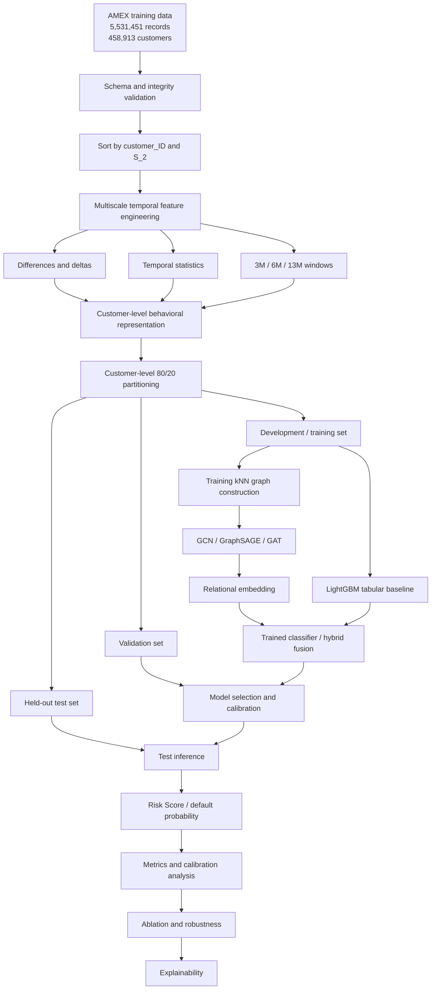

# GNN for Credit Card Default Prediction Using Relational and Temporal Features

This repository supports a machine learning research project on credit card default prediction using temporal feature engineering, customer-similarity graphs, Graph Neural Networks (GNNs), and hybrid tabular-relational models. The study uses the public **American Express Default Prediction (AMEX)** dataset.

The project tests whether a customer's financial behavior contains additional relational information when compared with the behavior of similar customers. Instead of representing each customer exclusively as an independent feature vector, the proposed method builds a graph in which customers are nodes and behavioral similarity defines the edges.

The second dimension of the study is temporal. Each customer's available financial history is represented over different observation horizons to determine whether relationships derived from recent, intermediate, and long-term behavior have different risk-discrimination capabilities.

The methodology combines three main components:

1. **Behavioral representation:** transformation of each customer's monthly history into statistical and temporal features.
2. **Relational representation:** construction of customer-similarity graphs.
3. **Graph learning:** use of GCN, GraphSAGE, and GAT to learn relational representations and classify customers according to their probability of default.

As analytical extensions, the study investigates a **calibrated Risk Score** and the **explainability of GNN decisions**. The scope focuses exclusively on the supervised relational-temporal core and excludes nonessential complexity such as reinforcement learning.

The central hypothesis is that **customer relational structure, combined with temporal information, provides additional predictive information that independent tabular models do not capture**.

## Final status

The project is finalized for the defined empirical scope. The complete
LightGBM baseline was executed on all 458,913 customers. The relational
experiments were executed with CUDA-enabled support at 25% and 50% of the
customer population, using the same customer-disjoint inductive protocol.
GraphSAGE was the strongest GNN family, but it did not outperform LightGBM.

The final conclusion is that, under this protocol, relational message passing
did not provide predictive gain over the tabular representation. The 50%
Hybrid OOF run was anomalous under GPU memory pressure and is excluded from
the conclusion. A 100% full-batch GNN run remains a scalability limitation,
not an unreported result.

See [`RELATORIO_RESULTADOS.md`](RELATORIO_RESULTADOS.md) for the consolidated
results and limitations.

## 0. Current Experimental Pipeline

The canonical project workflow is now the complete real-data pipeline. The
historical `src/mvp/` package and `artifacts/mvp/` directory are retained only
for backward-compatible smoke and bounded-result reproduction. They are not
the name or scope of the final project.

To run the complete protocol on all 458,913 customers:

```bash
python3 -m scripts.run_full_experiments
```

Use `--dry-run` to inspect the three phases before starting. Logs are written
to `logs/full-1.log`, `logs/full-2.log`, and `logs/full-3.log`; canonical
outputs are written under `artifacts/baseline/full/` and
`artifacts/experiments/full/`.

The total-scale command intentionally preserves the exact feature width and
protocol. It therefore requires sufficient RAM for the full customer-level
matrices and full-batch graph phases; it does not silently reduce the sample
or substitute a smaller experiment.

## 0.1 Baseline and final experiment artifacts

### 0.1 Implemented Scope

The historical bounded baseline is a reproducible **LightGBM tabular baseline**. It uses a small scope for smoke and development validation:

- lazy validation of partitioned Parquet features;
- loading and validation of customer labels from a Parquet file, CSV file, or partitioned Parquet directory;
- a deterministic sample capped at 10,000 customers;
- customer-disjoint and target-stratified train, validation, and test splits of 64%, 16%, and 20%;
- one complete-history temporal representation;
- numeric mean, standard deviation, minimum, maximum, last value, and first-to-last difference;
- latest-state encoding for the 11 predefined categorical variables;
- preprocessing fitted exclusively on the training partition;
- LightGBM training with validation-only early stopping and threshold selection;
- held-out ROC-AUC, PR-AUC, F1, Brier Score, ECE, and AMEX Score;
- execution logs, environment metadata, model weights, feature importance, and SHA-256 artifact manifests.

GNN training, graph construction, multiview features, hybrid fusion and
CUDA-enabled execution are implemented in the final experiment workflow.
Calibration fitting, operational Risk Score bands and individual
explanations remain outside the implemented scope.

### 0.2 Current Execution Status

The feature data was validated on September 5, 2026. Customer-level labels have since been added to the workspace as four Parquet partitions; their schema, coverage, and distribution still need to be verified by a real pipeline run.

| Assessment | Observed status |
|---|---|
| Data accessibility | Two readable Parquet partitions totaling 6,641,132,041 bytes |
| Records | 5,531,451 monthly records |
| Customers | 458,913 unique customers |
| Coverage | March 1, 2017 through March 31, 2018 |
| Schema | 190 columns: `customer_ID`, `S_2`, and 188 model attributes |
| Labels | Four Parquet partitions validated: 458,913 customers, 340,085 negatives and 118,828 positives |
| Hardware | Apple M1, 8 CPU cores, 8 GB RAM; feature partitions are about 3.1 GB each |
| Real AMEX baseline | Completed on all 458,913 customers |
| Synthetic smoke run | Passed end to end; used only to validate implementation |

The configured label location is `data/raw/parquet/train_labels/`, containing partitioned Parquet data with one `customer_ID` and one binary `target` per customer. A single Parquet or CSV file is also supported by changing `labels_path` in the configuration. The pipeline validates the label contract before training and preserves a diagnostic evidence package on failure.

Synthetic smoke metrics must not be reported as AMEX baseline results. They are deliberately separable from the real-data artifacts and exist only to prove that every pipeline stage executes:

| Synthetic smoke metric | Value |
|---|---:|
| ROC-AUC | 1.0000 |
| PR-AUC | 1.0000 |
| F1 | 1.0000 |
| Brier Score | 0.2256 |
| ECE | 0.4750 |
| AMEX Score | 0.9000 |

### 0.3 Reproduction

Python 3.13 is recommended for the current pinned environment.

```bash
python3.13 -m venv .venv
.venv/bin/python -m pip install -r requirements-dev.txt
.venv/bin/python -m pytest -q
.venv/bin/python -m scripts.generate_smoke_artifacts
.venv/bin/python -m src.baseline.run --config configs/baseline.json
```

On Windows with an NVIDIA GPU, install the CUDA-enabled GNN dependencies in a
short-path virtual environment to avoid Windows path-length issues:

```powershell
py -3.13 -m venv C:\gnn-venv
C:\gnn-venv\Scripts\python.exe -m pip install -r requirements-gnn.txt
C:\gnn-venv\Scripts\python.exe -m scripts.run_full_experiments
```

The GNN scripts use CUDA automatically when it is available and FAISS for
memory-bounded CPU kNN graph construction. Use `--device cuda` to require the
GPU or `--device cpu` to force CPU execution. Pass `--no-faiss` only for small
debugging datasets.
The LightGBM baseline and hybrid tabular classifier remain CPU-based.

The baseline command reads the supplied partitioned labels and trains the
real model. The complete CUDA experiment matrix can be run with:

```bash
python3 -m scripts.run_full_experiments --sample-customers 229457 --device cuda
```

The runner evaluates 3M, 6M, and 13M temporal windows with GCN, GraphSAGE,
and GAT under the same customer-disjoint inductive protocol. On Windows,
use a short virtual-environment path and the CUDA-enabled requirements
described above.

### 0.4 Real-data results

The real-data run used 10,000 customers with a fixed seed of 42, split into
6,400 training, 1,600 validation, and 2,000 test customers. The held-out
test metrics were:

| Model/view | AMEX Score | ROC-AUC | PR-AUC | Brier | ECE |
|---|---:|---:|---:|---:|---:|
| LightGBM, complete history | 0.7427 | 0.9522 | 0.8755 | 0.0770 | 0.0314 |
| Hybrid LightGBM + GraphSAGE, 13M, 3-fold OOF | 0.7037 | 0.9354 | 0.8393 | 0.0905 | 0.0647 |
| GCN, 3M | 0.6807 | 0.9182 | 0.8136 | 0.0946 | 0.0343 |
| GraphSAGE, 3M | 0.7253 | 0.9406 | 0.8524 | 0.0858 | 0.0259 |
| GAT, 3M | 0.6779 | 0.9212 | 0.8115 | 0.1294 | 0.1166 |
| GCN, 6M | 0.5881 | 0.8942 | 0.7488 | 0.1114 | 0.0252 |
| GraphSAGE, 6M | 0.7097 | 0.9404 | 0.8449 | 0.0866 | 0.0255 |
| GAT, 6M | 0.6596 | 0.9097 | 0.8117 | 0.1239 | 0.1123 |
| GCN, 13M | 0.6366 | 0.9089 | 0.7784 | 0.1058 | 0.0423 |
| GraphSAGE, 13M | **0.7321** | **0.9436** | **0.8569** | **0.0851** | 0.0331 |
| GAT, 13M | 0.6253 | 0.9044 | 0.7866 | 0.1209 | 0.0980 |

The complete consolidated results are in
[`RELATORIO_RESULTADOS.md`](RELATORIO_RESULTADOS.md). At 25%, LightGBM
obtained AMEX 0.7798 versus 0.7058 for the best GNN. At 50%, LightGBM
obtained AMEX 0.7819 versus 0.7084 for the best GNN. GraphSAGE was the best
GNN in both scales. The 50% OOF hybrid result is anomalous (AMEX -0.2297,
ROC-AUC 0.2439) because of GPU memory pressure and must not be reported.

Tracked evidence:

- [`artifacts/baseline/full/`](artifacts/baseline/full/): full-customer LightGBM baseline and metrics;
- [`artifacts/experiments/25pct/`](artifacts/experiments/25pct/): CUDA experiment results at 25%;
- [`artifacts/experiments/50pct/`](artifacts/experiments/50pct/): CUDA experiment results at 50%;
- [`artifacts/mvp/smoke/`](artifacts/mvp/smoke/): synthetic execution log, metrics, model weights, preprocessing state, feature importance, and manifest.

Raw data, row-level predictions, customer identifiers, processed matrices, and large experiment outputs are never included in these artifact packages.

### 0.5 Skills and Feasibility Assessment

This anonymous matrix evaluates repository evidence rather than claiming individual credentials.

| Capability | Current evidence | Status and mitigation |
|---|---|---|
| Parquet and Polars data engineering | Lazy partition discovery, schema validation, and customer filtering | Available and executed at full customer scale |
| Leakage-safe supervised evaluation | Customer-level stratified split and train-only preprocessing | Available and tested |
| LightGBM baseline modeling | Training, early stopping, persistence, and feature importance | Available and tested |
| Metrics and experimental reporting | AMEX Score, discrimination, calibration, logs, and manifests | Available and tested |
| PyTorch Geometric and GNN modeling | GCN, GraphSAGE, and GAT classifiers with a real-data multiview experiment runner | Results are recorded in `artifacts/mvp/gnn/metrics.json` |
| Scalable graph construction | Sparse FAISS-backed kNN with CUDA-capable experiment runner | Validated up to 50% of customers |
| Scientific reporting | Research questions, hypotheses, comparisons and limitations | Completed in `RELATORIO_RESULTADOS.md` |

All defined delivery gates are complete. A full-customer LightGBM baseline is
available, while the GNN protocol is reported at the largest stable scale
achieved with the available GPU memory. The project does not claim a
100%-customer full-batch GNN result.

## 1. Research Questions

### Main Research Question

> **Does the relational and temporal representation of customers through Graph Neural Networks improve credit card default detection compared with traditional tabular models?**

### Secondary Research Questions

1. Does constructing relationships among customers based on behavioral similarity add predictive information beyond individual attributes?
2. Do different temporal horizons produce relational structures with different default-detection capabilities?
3. Do GAT, GraphSAGE, and GCN behave differently when representing risk relationships among customers?
4. Does combining relational embeddings with tabular features improve performance compared with using the GNN alone?
5. Can the probabilities produced by the GNN be transformed into a calibrated and interpretable Risk Score?
6. Can model explanations identify which temporal features and customer relationships contributed to each decision?

## 2. Hypotheses

### H1: Relational Hypothesis

> Customers with similar financial and behavioral characteristics may exhibit related risk patterns, and using these relationships through a GNN improves default detection compared with models that treat each customer as an independent observation.

### H2: Temporal Hypothesis

> Representing customers over different temporal horizons captures different manifestations of financial behavior and produces complementary information for default prediction.

### H3: Hybrid Hypothesis

> Embeddings produced by the GNN may contain relational information complementary to tabular features, so combining both representations may outperform either representation used alone.

### H4: Explainability Hypothesis

> Joint analysis of feature contributions and customer relationships may provide more informative explanations of individual risk than analysis based exclusively on tabular feature importance.

## 3. Dataset

The study uses only the training portion of the **American Express Default Prediction** competition. In the current workspace, the feature table is stored as `data/raw/parquet/data_0.parquet` and `data/raw/parquet/data_1.parquet`, and customer-level labels are supplied separately in the partitioned Parquet directory `data/raw/parquet/train_labels/`. The competition's public test set will not be used to evaluate this study.

The experimental dataset contains approximately:

- **5,531,451 temporal records**;
- **458,913 unique customers**;
- approximately **190 original attributes**;
- up to 13 monthly observations per customer;
- a binary `target` associated with each `customer_ID`.

Variables are grouped into the following families:

- `D_*`: *Delinquency*;
- `S_*`: *Spend*;
- `P_*`: *Payment*;
- `B_*`: *Balance*;
- `R_*`: *Risk*.

Predefined categorical variables:

```text
B_30, B_38, D_114, D_116, D_117, D_120, D_126, D_63, D_64, D_66, D_68
```

The `customer_ID` will be used exclusively as an identifier and relational key.

## 4. Experimental Integrity Principles

1. **Split unit:** Customers will first be divided into an 80% development portion and a 20% held-out test portion. The validation fold will be drawn only from the development portion. All train, validation, and test partitions will be strictly customer-disjoint by `customer_ID`, preventing temporal or customer-identity leakage across folds.
2. **Use of the target:** The `target` will be used exclusively in the supervised loss function. It will never be used to calculate node similarity, create edges, or induce graph topology.
3. **Feature selection and normalization:** Any fitted statistical transformation will be learned strictly from the training fold and projected onto validation and test data.
4. **Inductive protocol:** The pipeline will prioritize inductive inference to simulate the arrival of new customers without rebuilding the complete existing topology.

Because the study evaluates generalization to unseen customers, its primary protocol follows this inductive sequence:

```text
Training data
  ↓
Training graph
  ↓
GNN training
  ↓
Frozen encoder
  ↓
New validation/test customers
  ↓
Construction of relationships allowed by the protocol
  ↓
Inference
```

Test labels will not be used to construct representations. A transductive evaluation may be conducted only as an additional experiment that is clearly identified and separated from the primary result.

## 5. Methodology Architecture



## 6. Multiscale Temporal Feature Engineering

Each customer's monthly temporal dimension will be condensed into static and dynamic features over the following windows:

- **Short term (3 months):** captures the most recent financial stress.
- **Medium term (6 months):** captures transitions in credit behavior.
- **Long term (13 months):** captures complete history and customer stability.

### Temporal Operations

- Successive differences: $\Delta X_t = X_t - X_{t-1}$.
- Descriptive statistics: mean, standard deviation, minimum, maximum, first record, and last record.
- Trends and slopes: `total_delta` = $X_{\mathrm{last}} - X_{\mathrm{first}}$, and `avg_monthly_slope` = $\frac{X_{\mathrm{last}} - X_{\mathrm{first}}}{n - 1}$.
- Volatility and categorical-state dynamics, including the number of transitions and the last state.

The implemented `aggregate_temporal_features` utility preserves the historical
full-history schema by default and derives independent 3M/6M/13M views.
Windowed numeric features include mean, standard deviation, minimum, maximum,
first/last values, total difference, and average slope; categorical features
include the latest state, number of observed states, and within-window
transitions. The real-data runner executes the three-horizon comparison.

## 7. Behavioral Graph Construction and Scalability

- **Nodes ($V$):** customers ($N \approx 458{,}913$).
- **Edges ($E$):** behavioral-similarity relationships calculated with $k$-Nearest Neighbors ($k$-NN) over normalized features.
- **Multiview topology:** three independent sparse graphs, $G_{3M}$, $G_{6M}$, and $G_{13M}$.
- **M1 scalability and out-of-memory prevention:**
  - Approximate Nearest Neighbors, such as Annoy, HNSW, or FAISS, to avoid $O(N^2)$ pairwise construction.
  - Sparse edge-list storage through `torch_geometric.data.Data(edge_index=...)`, without materializing dense adjacency matrices.
  - Mini-batching through neighbor sampling with `NeighborLoader`.

The `GraphFeatureScaler` fits standardization on training nodes and applies the
fixed transform to held-out nodes. The graph utilities construct sparse
directed training graphs and inductive train-to-query edges using scikit-learn
or FAISS. Both utilities reject non-finite inputs. Cosine distance and
additional graph diagnostics remain outside the final evaluated scope.

## 8. Models, Multiview Fusion, and Hybrid Approach

### 8.1 Compared GNNs

- **GCN:** baseline with isotropic convolutional aggregation.
- **GraphSAGE:** efficient inductive neighbor sampling and aggregation.
- **GAT:** adaptive attention coefficients assigned to behavioral edges.

At least these three GNN families will be evaluated.

#### GCN

The Graph Convolutional Network will be used as the graph-convolution baseline. Its role is to determine whether simple neighborhood information aggregation already provides a gain over the tabular model.

#### GraphSAGE

GraphSAGE will be used as an alternative based on neighbor aggregation and node-embedding generation, enabling a configuration more compatible with inference for new customers.

#### GAT

The Graph Attention Network is the primary candidate architecture. GAT assigns different weights to relationships between a node and its neighbors, allowing the study to investigate whether some behavioral relationships are more relevant than others.

The comparison will assess which mechanism best represents customer risk relationships:

```text
GCN
 ↓
GraphSAGE
 ↓
GAT
```

The repository includes a two-layer `GraphClassifier` supporting GCN,
GraphSAGE, and GAT, plus a full-batch trainer that restores the best
validation-loss checkpoint and rejects query-to-training message edges. The
experiment runner builds training-only graphs, queries validation and test
customers independently, and returns probabilities and frozen embeddings. The
three-horizon real-data benchmark is recorded in the results report.

### 8.2 Multiview Fusion

Concatenation and an attention mechanism will combine the three temporal-view representations, $H_{3M}$, $H_{6M}$, and $H_{13M}$.

### 8.3 Hybrid Model

Relational embeddings learned by the GNN will be joined with the original tabular vectors and provided to a Gradient Boosting classifier such as LightGBM. The current `HybridLightGBMClassifier` concatenates tabular features and GNN embeddings for fitting and prediction. The final experimental pipeline will use out-of-fold GNN representations when training the second-stage classifier.

## 9. Ablation Studies

The ablation study is a central component of the scientific contribution because it separates the effect of each part of the methodology. Every comparison will preserve the same customer split, preprocessing protocol, and, where applicable, training budget. Consequently, performance differences can be attributed primarily to the component under evaluation.

Configurations will be selected using the training and validation sets. The held-out test set will be used only for the final evaluation of the selected configurations, preventing indirect adaptation to test results.

The main metrics will be AMEX Score, ROC-AUC, PR-AUC, F1 Score, Brier Score, and Expected Calibration Error (ECE). Because default prediction is imbalanced, PR-AUC will receive priority in complementary discrimination analysis, while Brier Score and ECE will evaluate probability quality. The official AMEX Score remains the primary competition-aligned metric.

### 9.1 Ablation 1: Relationships

```text
Complete model
  ↓
Remove edges
  ↓
Attribute-only model
```

In this comparison, the complete model uses customer attributes and the k-NN neighborhood structure. In the no-edge condition, the same individual representation is preserved, but message passing or aggregation among customers is removed.

**Objective:** verify the specific gain from relational structure and test whether customer relationships provide predictive information beyond individual attributes.

An improvement of the complete model over the no-edge model will support the relational hypothesis. Representation dimensionality, classifier, and other hyperparameters should remain as equivalent as possible.

### 9.2 Ablation 2: Temporality

```text
13M
 ↓
6M
 ↓
3M
 ↓
3M + 6M + 13M
```

Representations built from the complete 13-month history, the intermediate 6-month window, the recent 3-month window, and the combination of all three windows will be compared. Each configuration must generate its own temporal features and, where applicable, its own similarity graph.

**Objective:** identify the contribution of each temporal horizon and determine whether combining short-, medium-, and long-term information provides complementary information.

In addition to mean performance, calibration and stability differences will be analyzed. For example, the 3-month window may capture recent financial stress, whereas the 13-month window may better represent a customer's historical stability.

### 9.3 Ablation 3: GNN Architecture

```text
GCN
 ↓
GraphSAGE
 ↓
GAT
```

The architectures will be trained on the same node representation and topology whenever the architecture permits. The number of layers, embedding dimension, optimizer, and stopping criterion will be controlled to make the comparison fairer.

**Objective:** evaluate the effect of the aggregation mechanism on risk classification.

GCN represents more uniform convolutional aggregation, GraphSAGE emphasizes inductive aggregation, and GAT assigns different attention weights to relationships. Training time, memory consumption, and parameter count will also be recorded because the best model will not be determined solely by a predictive metric.

### 9.4 Ablation 4: Fusion

```text
Concatenation vs. attention fusion
```

With concatenation, embeddings produced by the temporal views are joined directly before classification. With attention fusion, the model learns weights that combine the 3M, 6M, and 13M representations according to their relevance to each customer or task.

**Objective:** determine whether attention across temporal horizons provides a real gain over simple fusion.

In addition to performance, attention weights may be analyzed to determine whether the model consistently prioritizes one temporal window or uses different horizons for different customer profiles. This interpretation will be treated as descriptive evidence, not causality.

### 9.5 Ablation 5: Hybrid Representation

```text
Tabular
   vs.
GNN
   vs.
Tabular + GNN
```

Three representations will be compared for the final classifier:

1. **Tabular:** only the customer's behavioral and temporal features.
2. **GNN:** only the relational embedding learned by the GNN.
3. **Tabular + GNN:** a combination of tabular features and the relational embedding.

**Objective:** investigate whether the relational representation contains complementary information and whether hybrid fusion outperforms either source used alone.

To prevent vector size alone from influencing the comparison, representation dimensions will be documented and classifiers of comparable complexity will be used when necessary. The most relevant result will be the difference between the hybrid model and the two standalone models.

### 9.6 Ablation 6: Graph Structure

Different values of `k`, including `k = 5`, `k = 10`, and `k = 20`, will be evaluated to observe the effect of neighborhood density on performance, memory, and processing time. If computationally feasible, different similarity functions, such as Euclidean distance and cosine similarity, will also be compared.

**Objective:** determine whether the results depend on a specific topology choice and identify a stable range of configurations.

The value of `k`, the similarity function, and any associated normalization will be defined without using `target` to create edges. The comparisons will also determine whether denser graphs increase cost without producing consistent predictive gains.

### 9.7 Comparison Protocol

For each ablation, the following will be recorded:

- complete configuration and the component removed or changed;
- data split and random seed;
- number of parameters, training time, and memory usage when measurable;
- AMEX Score, ROC-AUC, PR-AUC, F1 Score, Brier Score, and ECE;
- absolute difference from the complete model;
- variation across repetitions when multiple runs are available.

Conclusions will be based on consistent differences among configurations rather than on a single metric or execution. When a difference is small, the component's contribution will be reported as limited or inconclusive.

## 10. Robustness Study

The robustness study will determine whether the conclusions remain similar when reasonable experimental conditions change. Its purpose is to distinguish a structural methodological gain from a result dependent on a random seed, a value of `k`, or a particular architecture choice.

Robustness will be evaluated across:

- different random seeds;
- different values of `k`;
- different GNN architectures;
- different similarity functions;
- different temporal horizons;
- different fusion strategies.

Whenever possible, multiple independent repetitions will be performed while preserving the customer split. For each configuration, the mean and standard deviation of the metrics will be calculated:

$$
\mathrm{result} = \mathrm{mean} \pm \mathrm{std}
$$

The worst and best results across repetitions will also be observed, especially for PR-AUC, Brier Score, and ECE. A configuration will be considered more robust when it maintains competitive performance with low variability and without excessive degradation under alternative conditions.

Robustness analyses will not replace the final evaluation on the held-out test set. They will be conducted using training and validation data; after the final configuration is selected, it will be evaluated once on the reserved test set. This keeps model selection separate from the final generalization estimate.

## 11. Calibration, Risk Score, and Explainability

- **Risk Score:** monotonic mapping of estimated default probabilities ($PD \in [0,1]$) to an interpretable credit scale from 0 to 1000.
- **Calibration:** evaluation with Brier Score and Expected Calibration Error (ECE), using Platt Scaling or Isotonic Regression fitted on the validation fold.
- **Explainability:**
  - **Global:** importance of tabular features through SHAP.
  - **Relational and local:** identification of influential neighbors and critical subgraphs through GAT attention weights and GNNExplainer.

## 12. Research Schedule

The project schedule covers ten weeks, beginning with the submission of the proposal and ending on October 31.

| Activity | Weeks 1-2 | Weeks 3-4 | Weeks 5-6 | Weeks 7-8 | Weeks 9-10 (until 10/31) |
|---|:---:|:---:|:---:|:---:|:---:|
| State-of-the-art survey | X |  |  |  |  |
| Dataset processing | X | X |  |  |  |
| Experiment 1: tabular baselines and pilot graphs |  | X | X |  |  |
| Experiment 2: GNN architectures: GCN, GraphSAGE, GAT |  |  | X |  |  |
| Experiment 3: multiview, hybrid model, and calibration |  |  | X | X |  |
| Results analysis and explainability |  |  | X | X |  |
| Manuscript writing |  |  | X | X | X |

## 13. Repository and Source Code

The repository separates reusable source modules from local datasets,
experimental scripts, sanitized evidence, and research documents. The current
implementation includes the final tested tabular and graph experiment workflow.

### 13.1 Current Source Modules

- `src/data/parquet_dataset.py`: validates feature partitions and customer-level labels, profiles the dataset, and loads selected customers.
- `src/preprocessing/splitting.py`: creates deterministic, stratified, customer-disjoint partitions.
- `src/preprocessing/transformations.py`: learns imputations, feature filtering, and categorical mappings from training data only.
- `src/preprocessing/graph_scaling.py`: fits graph-feature standardization on training nodes and reuses it for query nodes.
- `src/temporal_features/aggregation.py`: aggregates customer histories into numerical statistics and latest categorical states.
- `src/models/lightgbm_baseline.py`: trains, evaluates, and saves the tabular baseline.
- `src/evaluation/metrics.py`: implements AMEX Score, ROC-AUC, PR-AUC, F1, Brier Score, and ECE.
- `src/reporting/artifacts.py`: writes atomic artifacts and SHA-256 manifests.
- `src/mvp/pipeline.py` and `src/mvp/run.py`: provide orchestration and the command-line entry point.
- `src/experiments/gnn.py`: runs an inductive GNN experiment for a single temporal feature view and produces held-out probabilities and embeddings.
- `src/graph/knn_graph.py`: validates feature matrices and builds sparse directed k-NN edge indices with scikit-learn or FAISS.
- `src/models/gat.py`: provides a two-layer PyTorch Geometric GAT classifier for node-level prediction.
- `src/models/gnn.py`: implements GCN, GraphSAGE, and GAT classifiers, validation-based early stopping, and inductive query prediction.
- `src/models/hybrid.py`: concatenates tabular features with GNN embeddings and trains a LightGBM classifier.
- `tests/`: covers configuration, schemas, splitting, temporal aggregation, preprocessing, metrics, privacy, artifact integrity, and the end-to-end CLI.
- `requirements.txt`: pins the tabular runtime; `requirements-gnn.txt` contains the CUDA/GNN experiment dependencies.
- `overleaf/`: existing local directory reserved for the research article and related publication assets.

### 13.2 Current and Planned Directory Structure

The markers below distinguish the current filesystem from the intended architecture:

- `[existing]`: currently present in the repository workspace.
- `[planned]`: to be created as implementation progresses.
- `[local]`: generated or dataset content intended to remain outside version control.

```text
.
├── .gitignore                                      [existing]
├── LICENSE                                         [existing]
├── README.md                                       [existing]
├── requirements.txt                                [existing, MVP]
├── requirements-dev.txt                            [existing, tests]
├── requirements-gnn.txt                            [existing, future GNN work]
├── configs/mvp.json                                [existing]
├── artifacts/mvp/                                  [existing, tracked evidence]
│   ├── baseline/                                   [existing, real-data preflight]
│   └── smoke/                                      [existing, synthetic validation]
├── overleaf/                                       [existing]
│   └── publication sources and assets              [planned]
├── data/                                           [existing, local]
│   ├── parquet/                                    [existing, local]
│   │   └── raw/                                    [existing, local]
│   │       ├── data_0.parquet                      [existing, local]
│   │       ├── data_1.parquet                      [existing, local]
│   │       └── train_labels/                       [existing, four local Parquet partitions]
│   ├── temporal/                                   [planned, local]
│   ├── customer_features/                          [planned, local]
│   └── graphs/                                     [planned, local]
│       ├── train/                                  [planned, local]
│       ├── validation/                             [planned, local]
│       └── test/                                   [planned, local]
├── experiments/                                    [planned, local]
│   ├── baselines/                                  [planned, local]
│   ├── gnn/                                        [planned, local]
│   ├── fusion/                                     [planned, local]
│   ├── ablation/                                   [planned, local]
│   └── robustness/                                 [planned, local]
├── results/                                        [planned, local]
│   ├── metrics/                                    [planned, local]
│   ├── figures/                                    [planned, local]
│   ├── explanations/                               [planned, local]
│   └── models/                                     [planned, local]
└── src/                                            [existing]
    ├── data/parquet_dataset.py                     [existing]
    ├── preprocessing/                              [existing]
    │   ├── splitting.py                            [existing]
    │   └── transformations.py                      [existing]
    ├── temporal_features/                          [existing]
    │   └── aggregation.py                          [existing]
    ├── graph/                                      [existing]
    │   ├── similarity.py                           [planned]
    │   ├── knn_graph.py                            [existing]
    │   └── graph_validation.py                     [planned]
    ├── models/                                     [existing]
    │   ├── lightgbm_baseline.py                    [existing]
    │   ├── gcn.py                                  [planned]
    │   ├── graphsage.py                            [planned]
    │   ├── gat.py                                  [existing]
    │   ├── multiview.py                            [planned]
    │   └── hybrid.py                               [existing]
    ├── risk/                                       [planned]
    │   ├── calibration.py                          [planned]
    │   └── scoring.py                              [planned]
    ├── explainability/                             [planned]
    │   ├── gnn_explainer.py                        [planned]
    │   └── feature_analysis.py                     [planned]
    ├── reporting/artifacts.py                      [existing]
    ├── mvp/                                        [existing]
    │   ├── config.py                               [existing]
    │   ├── pipeline.py                             [existing]
    │   └── run.py                                  [existing]
    └── evaluation/                                 [existing]
        ├── metrics.py                              [existing]
        ├── ablation.py                             [planned]
        └── robustness.py                           [planned]
```

Local datasets and heavy output directories must not be committed. Only sanitized files under `artifacts/mvp/` are intended for Git. These packages must not contain raw records, customer identifiers, or row-level predictions.

### 13.3 Dependencies

The default dependencies provide the executable tabular baseline, while
`requirements-gnn.txt` adds the CUDA/GNN experiment stack:

- Pandas and Polars for tabular and temporal processing;
- PyArrow for Parquet metadata and schema validation;
- scikit-learn for splitting and evaluation;
- LightGBM for tabular and hybrid models;
- psutil and joblib for environment reporting and preprocessing persistence.

Install them with:

```bash
python -m pip install -r requirements-dev.txt
```

Future graph experiments can install `requirements-gnn.txt` after the baseline gate passes.

## 14. Final Considerations

This research establishes a rigorous investigation into the information gain produced by relational structures combined with different temporal horizons in the financial domain. By focusing on the supervised core and excluding unnecessarily costly approaches such as reinforcement-learning formulations, the project preserves experimental rigor and remains technically and computationally feasible for the team.

The completed workflow preserves customer-disjoint evaluation,
target-independent topology construction, inductive inference, sparse graph
processing, reproducible comparisons, and held-out test evaluation. The
remaining limitations are documented in `RELATORIO_RESULTADOS.md`, including
the absence of operational Risk Score calibration/explanations and the
instability of the 50% OOF hybrid under GPU memory pressure.